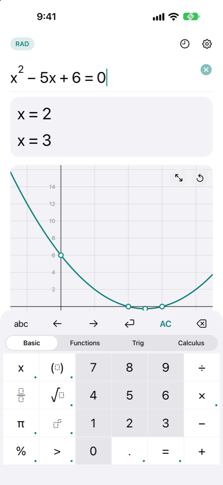
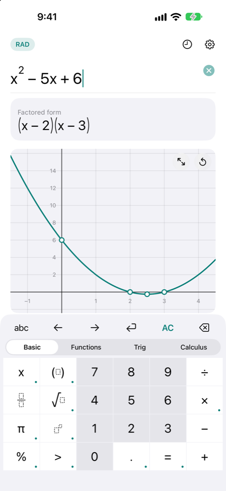
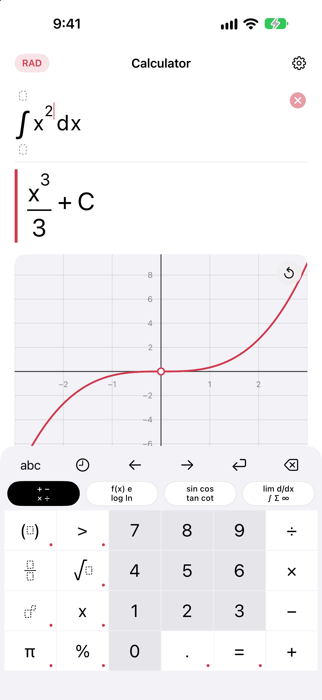

# Mantissa

A free scientific and graphing calculator for iPhone. It works entirely offline, shows exact results (fractions,
roots, π), solves equations and keeps a history. No ads, no accounts, no network access.

> **Status: early development.** The calculator, history, graphs, equations, systems and inequalities work in the iOS
> Simulator. Not released yet.

<p>
  
  
  
</p>

Everything is worked out on the phone and nothing is sent anywhere; see [PRIVACY.md](PRIVACY.md).

## Features

Working today (in the `MantissaCore` package):

- Arbitrary-precision integers (`BigInt`).
- Exact fractions (`Rational`), including exact parsing of decimals such as `0.1` and `2.5e-3`.
- Arbitrary-precision decimals (`BigDecimal`) with π, e, square roots, powers, `exp`, `ln`, `log`, the trigonometric,
  inverse trigonometric and hyperbolic functions, rounded to the last digit (checked against Python's `decimal` at 15,
  50 and 100 digits).

- A calculator engine: type `√12 + √3`, `sin(15°)`, `1/(1+√2)`, `(x+1)*2` or `5!` and get the exact answer
  (`3√3`, `√6/4 - √2/4`, `-1 + √2`, `2x + 2`, `120`) and a decimal approximation to any precision. Radians, or degrees
  with the ° sign (`sin(15°)`); English or Japanese full-width input.

- An iPhone app on top of the engine: a maths keyboard with stacked fractions and roots, a live exact and decimal
  answer, a history of solved problems (saved on the phone), and graphs of functions of x with their roots, extrema and
  crossings marked, solutions of equations (exact where there is a closed form, complex ones included, the rest as
  decimals), equations with roots, absolute values, exponentials, logarithms and trigonometric functions (`sin x = 1/2`
  is `π/6 + 2πn` or `5π/6 + 2πn`), systems of equations, and inequalities in one unknown (`x² > 4` is `x < −2 or x > 2`).
  English and Japanese (the language can be chosen in the app).
- An answer with an unknown in it also shows its expanded and factored forms (`x² − 5x + 6` is `(x − 2)(x − 3)`), and a fraction
  with common factors is shown simplified. Radians or degrees, and the number of digits, are settings.

- Calculus: derivatives (`d/dx`), integrals (indefinite, definite and improper), limits (including at ∞ and one-sided) and
  sums and series, with exact answers (`∫ x e^x dx`, `lim (1 + 1/x)^x = e`, `Σ 1/k² = π²/6`).

The keyboard places ∫, Σ, lim and d/dx with boxes for their expression, variable and ends, as in the app this one follows.
`log` with a base is typed with its base small below it (`log₂(8)`), and a small + or − after the point of a limit means from above
or from below.

- Also: `mod`, `min`, `max`, `sign`, the real and imaginary parts, conjugate and argument of a complex number, `atan(y, x)`, and
  the reciprocal trigonometric and hyperbolic functions with their inverses.
- Trigonometric inequalities (`sin x > 1/2` is `π/6 + 2πn < x < 5π/6 + 2πn`), trigonometric identities in answers (`sin²x + cos²x`
  is 1), the Gaussian integral (`∫ e^(−x²) dx` over the line is √π) and the integrals of sec and csc.
- Paste a formula from anywhere (`2x^2 + sqrt(3)`) and it is laid out like one typed on the keyboard; hold the answer to copy
  it as text or to use it as the next input; hold the delete or arrow key to repeat it.
- Systems such as `x² + y² = 10, xy = 3`, logarithms of powers of a prime (`ln 8` is `3 ln 2`, so `log₂x + log₄x = 3` gives 4), and a
  sum of fractions in several letters as one fraction (`1/x + 1/y` is `(x + y)/(xy)`).
- Graphs: tap a curve to read its coordinates, hold and drag to follow it, and open it full screen.
- Graphs of circles and other curves in x and y (`x² + y² = 25`, with the intercepts marked) and shaded regions for inequalities
  (`y > x²`, dashed where the edge is not included); a line and a circle show where they cross.

## Getting started

Needs Xcode (Swift 6) on macOS.

```bash
swift build
swift test
```

## Architecture

The engine is a Swift package with no dependencies; the app will sit on top of it. See `docs/design.md`.

## Quality checks

```bash
xcrun swift-format lint --strict -r Sources Tests Package.swift
swift test
```

## Licence

Mantissa is released under the MIT licence: Copyright (c) 2026 Kosuke Satake (see [LICENSE](LICENSE)). It has no
third-party code or data: see [THIRD_PARTY.md](THIRD_PARTY.md).

This project accepts issues, not code contributions.

## About the making of this app

This app was built with the help of Claude (Anthropic) through Claude Code; design, review and testing are by Kosuke Satake. Anthropic does not endorse this app.
